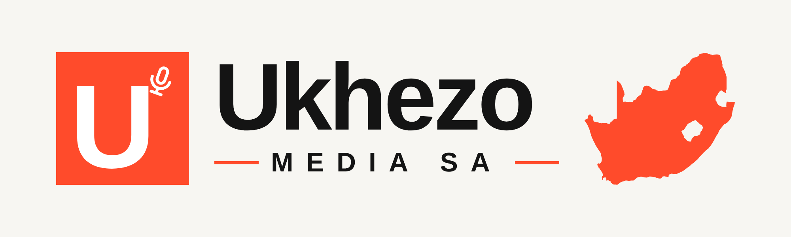

# Ukhezo Media SA

Website for **Ukhezo Media SA**, a creative studio in Greytown, KwaZulu-Natal, South Africa.

**Live site: https://ukhezo.github.io/ukhezo-media/**

## Services

- **Graphic design:** logos, branding, posters, flyers, menus, infographics
- **Websites:** business websites, online shops, landing pages
- **Photo & video:** product photos, events, promo videos, headshots
- **Social media:** content calendars, post design, page management, ads

## Contact

- Call / WhatsApp: **069 374 6295**
- Email: **ukhezomediasa@gmail.com**
- Based in **Greytown, KwaZulu-Natal**

## About the site

A single-page website in plain HTML, CSS and JavaScript, with no frameworks. It's hosted free on GitHub Pages.

- Phone-friendly layout with a floating WhatsApp button
- Quote-request form that sends to email (Web3Forms), falling back to the visitor's email app
- Work section linking to live projects
- Link preview image for WhatsApp, Facebook and LinkedIn

To change any text, edit `index.html` on GitHub (pencil icon, then **Commit changes**). The site updates in 1–2 minutes.
